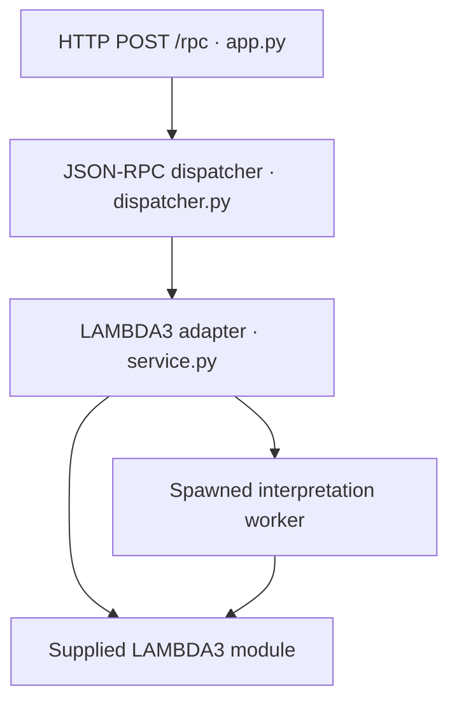

# LAMBDA3 JSON-RPC service

Python **3.12+** is required because the supplied language uses PEP 695
syntax. Verified with Python 3.12.14, Flask 3.1.3, and jsonschema 4.26.0.

All submission files belong in `assigns/07/MySolution/`. The supplied language
and user-provided support module are included in `MySolution/LAMBDA3/`. The required RPC demonstrations use built-inLAMBDA3 operations and need no additional modules.

## Setup, tests, and startup

Run these commands from the repository's `assigns/07/` directory:

```bash
python3 --version
python3 -m venv .venv
source .venv/bin/activate
python3 -m pip install -r MySolution/requirements.txt
python3 -m unittest discover -s MySolution -p 'test_*.py' -v
python3 MySolution/app.py
```

Endpoint: `http://127.0.0.1:8000/rpc`. This is a local development server.
Use another terminal for the requests below. Stop with Ctrl+C. 

## Curl demonstrations

Health:
```bash
curl -sS http://127.0.0.1:8000/rpc -H 'Content-Type: application/json' \
  -d '{"jsonrpc":"2.0","id":"health","method":"service.health","params":{}}'
```
Expected result: `{"status":"ok","version":"1.0"}` inside the RPC envelope.

Type-check arithmetic:
```bash
curl -sS http://127.0.0.1:8000/rpc -H 'Content-Type: application/json' \
  -d '{"jsonrpc":"2.0","id":1,"method":"lambda.typecheck","params":{"source":"6 * 7"}}'
```
Expected result: `{"type":"sint"}`.

Interpret factorial:
```bash
curl -sS http://127.0.0.1:8000/rpc -H 'Content-Type: application/json' \
  -d '{"jsonrpc":"2.0","id":2,"method":"lambda.interpret","params":{"source":"let fact : sint -> sint = fix fact(n: sint): sint => if n <= 1 then 1 else n * fact(n - 1) in fact(6) end"}}'
```
Expected result: `{"type":"sint","value":"720"}`.

Unbound-variable error:
```bash
curl -sS http://127.0.0.1:8000/rpc -H 'Content-Type: application/json' \
  -d '{"jsonrpc":"2.0","id":3,"method":"lambda.typecheck","params":{"source":"missing"}}'
```
Expected RPC error: `-32011`, with an unbound-variable diagnostic, HTTP 200.

Compile to Python:
```bash
curl -sS http://127.0.0.1:8000/rpc -H 'Content-Type: application/json' \
  -d '{"jsonrpc":"2.0","id":4,"method":"lambda.compile","params":{"source":"6 * 7","target":"python"}}'
```
Compile to JavaScript:
```bash
curl -sS http://127.0.0.1:8000/rpc -H 'Content-Type: application/json' \
  -d '{"jsonrpc":"2.0","id":5,"method":"lambda.compile","params":{"source":"6 * 7","target":"javascript"}}'
```
Both return a `target` and the complete generated `code` string. The service
never runs this generated code. Full recorded HTTP client demonstrations are
in `examples/`, including factorial, type error, and compilation.

Notification (observe HTTP 204 and no body):
```bash
curl -i http://127.0.0.1:8000/rpc -H 'Content-Type: application/json' \
  -d '{"jsonrpc":"2.0","method":"service.health","params":{}}'
```

## Limits, contract, and architecture

Source limit: 16,384 UTF-8 bytes. Interpretation deadline: 2.0 seconds with
process termination. HTTP body limit: 1 MiB. `RPC.md` specifies errors,
parameter rules, batches, IDs, and transport status. `rpc-schema.json`
describes request/response envelopes. `TESTING.md` maps requirements to tests.



The transport parses JSON; the dispatcher validates envelopes; the adapter
validates method parameters and invokes LAMBDA3. Interpretations run in child
processes with only formatted results crossing the boundary. Tests use
Flask's HTTP test client; successful language operations invoke the supplied
implementation, with doubles only for failure injection.