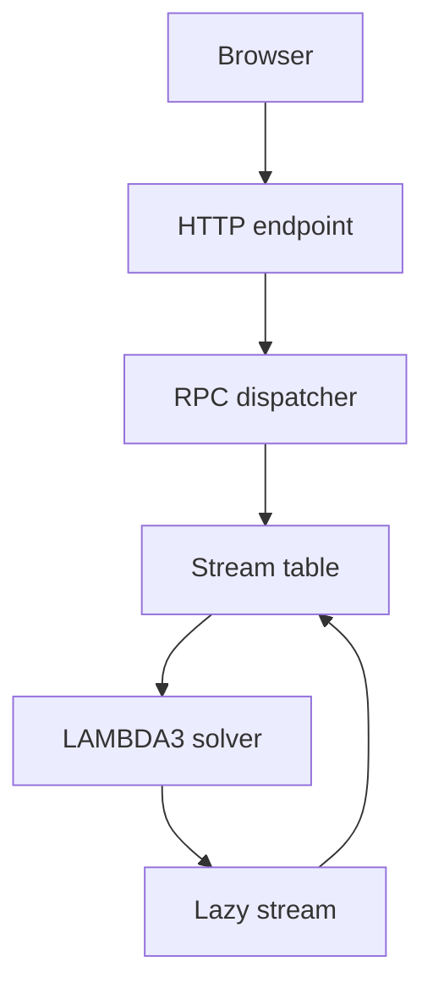

# Design: animated N-Queens

The LAMBDA3 solver owns every search decision. Python only loads the fixed
reviewed program, holds lazy values, forces bounded prefixes, and converts events.
The browser consumes one event per request and renders board snapshots.

## State and invariant

`size` is 4–10. Search state is `(row, column, board, success, failure)`.
`board` is an immutable LAMBDA3 list, newest row first. It has exactly `row`
columns; all placed queens occupy different columns and diagonals. Each search
level owns one row, so two queens cannot occupy the same row. The adapter reverses
this list to JSON row order. `extend(column, board)` is pure list construction.

## Continuations and order

Write `E = (sint, sint, sint, List[sint])`, `S = Strm[E]`, and
`K = unit -> S` as documentation abbreviations (the program spells types out).
`success : (Board, K) -> S`; `failure, on_safe, on_conflict : K`.
`safe(column, distance, board, on_safe, on_conflict)` calls a continuation,
never returns a Boolean. Distance starts at 1 and increases toward older rows.
An equal column or column difference of ±distance is a collision.

```
search(row, column, board, success, failure):
  if row == size: success(board, failure)
  else if column == size: failure()
  else emit(try, () => safe(column, 1, board,
    () => emit(place, () => search(row+1, 0, extend(column,board), success,
      () => emit(backtrack, () => search(row,column+1,board,success,failure)))),
    () => emit(reject, () => search(row,column+1,board,success,failure))))
success(board, resume) = emit(solution, resume)
root_failure() = emit(done, () => empty_stream)
```

The single recursive `search` combines row entry and trying columns, avoiding
mutually recursive declarations. Columns increase left to right. The failure
closure captures the parent board and next column. Success preserves that exact
closure, allowing search to continue after a solution without duplicates.
All recursive safety calls, search calls, and continuation invocations occur in
tail position in the LAMBDA source. The supplied Python evaluator itself is
recursive; this design does not claim that it implements general tail-call optimization.

## Lazy boundary

Opening evaluates only fixed helper closures and a `lazy_make` expression.
It does not call search. `emit(event, tail_thunk)` wraps a constructor in
`lazy_make`, and its tail separately suspends invoking `tail_thunk`.
Thus creating a cell never invokes its continuation. A force can scan at most
one candidate's earlier queens before exposing its event. Fetching the tail
value never forces it. On `done`, the adapter discards the live closure graph.
Instrumentation counts actual `search` and `safe` function-body entries in the
provided evaluator, as well as observable force calls. Tests also inspect
unevaluated tails and use a delayed division by zero.

## Event schema

| Tag | JSON event | Fields |
|---|---|---|
| 0 | try | row, column, board before placement |
| 1 | place | row, column, board after placement |
| 2 | reject | row, column, unchanged board |
| 3 | backtrack | row, column, restored parent board |
| 4 | solution | complete board |
| 5 | done | no additional fields |

The internal tuple is `(tag,row,column,reversed_board)`. Solution/done use -1
coordinate sentinels which are omitted in JSON. Events contain snapshots, so the
client can recover its display without reconstructing interpreter state.

## Stream lifetime and errors

A UUID identifies a process-local stream. A single reentrant service lock covers
validation, cleanup, lookup, force, and cursor replacement, making each request
atomic. Idle lifetime is 300 seconds measured by a monotonic clock. Access to
`next` refreshes it. Cleanup runs on every method, plus every second in the
server loop, and is independently callable for deterministic tests.

On exhaustion the live stream is removed; a small tombstone records the ID so
repeated next returns `events: [], done: true`. Tombstones expire after the same
idle lifetime and are removed on close. At most 128 active streams and 1024
completion tombstones are retained; the oldest tombstone is evicted if needed.
An evicted, closed, unknown, or expired ID yields `-32001` (stream unavailable).
Capacity yields `-32002`. Close on an exhausted ID succeeds; repeated close is
an unavailable-ID error. Restart invalidates all IDs.

Parameters must be exact objects with the documented keys. Integers exclude
Booleans. Size is 4–10; limit is 1–32. No source text or function names are
accepted. Errors: parse -32700, envelope -32600, method -32601, parameters
-32602, internal -32603. Responses hide internal details. Valid notifications
execute normally but return HTTP 204 without a body, including method errors.
Batches are not supported and return invalid request. Valid IDs are null,
strings, integers, or finite floats; malformed requests use null ID.

## JSON-RPC examples

Every call is POST `/rpc`, Content-Type `application/json`, HTTP 200.
`id` is preserved; stream IDs below are placeholders.

```json
{
    "jsonrpc": "2.0",
    "method": "service.health",
    "params": {},
    "id": 1
}
{
    "jsonrpc": "2.0",
    "result": 
    {
        "status": "ok",
        "version": "1.0"
    },
    "id": 1
}

{
    "jsonrpc": "2.0",
    "method": "queens.open",
    "params": 
    {
        "size": 8
    },
    "id": 2
}
{
    "jsonrpc": "2.0",
    "result": 
    {
        "stream_id": "UUID",
        "size": 8
    },
    "id": 2
}

{
    "jsonrpc": "2.0",
    "method": "queens.next",
    "params": 
    {
        "stream_id": "UUID",
        "limit": 1
    },
    "id": 3
}
{
    "jsonrpc": "2.0",
    "result": 
    {
        "events":
        [{
            "event": "try",
            "row": 0,
            "column": 0,
            "board": []
        }],
        "done": false
    },
    "id":3}

{
    "jsonrpc": "2.0",
    "method": "queens.close",
    "params": 
    {
        "stream_id": "UUID"
    },
    "id": 4
}
{
    "jsonrpc": "2.0",
    "result": 
    {
        "closed": true
    },
    "id": 4
}
```

## Architecture

